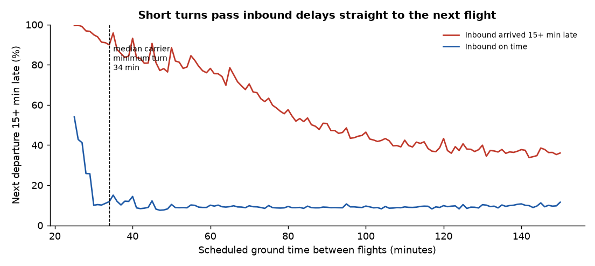
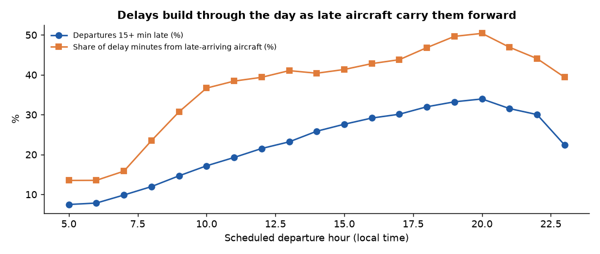
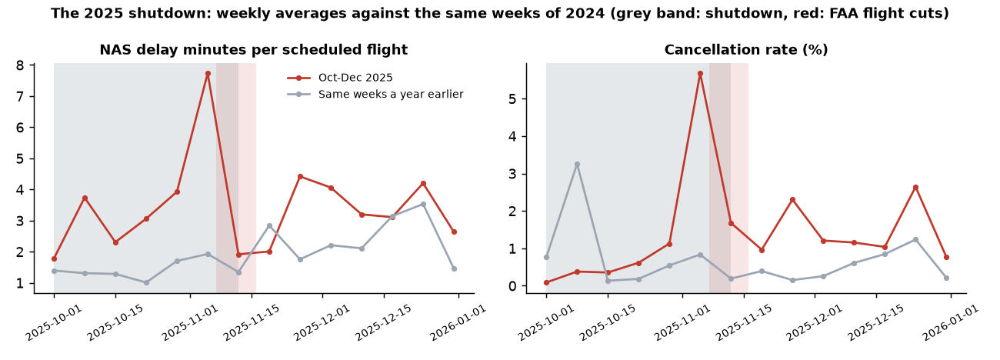
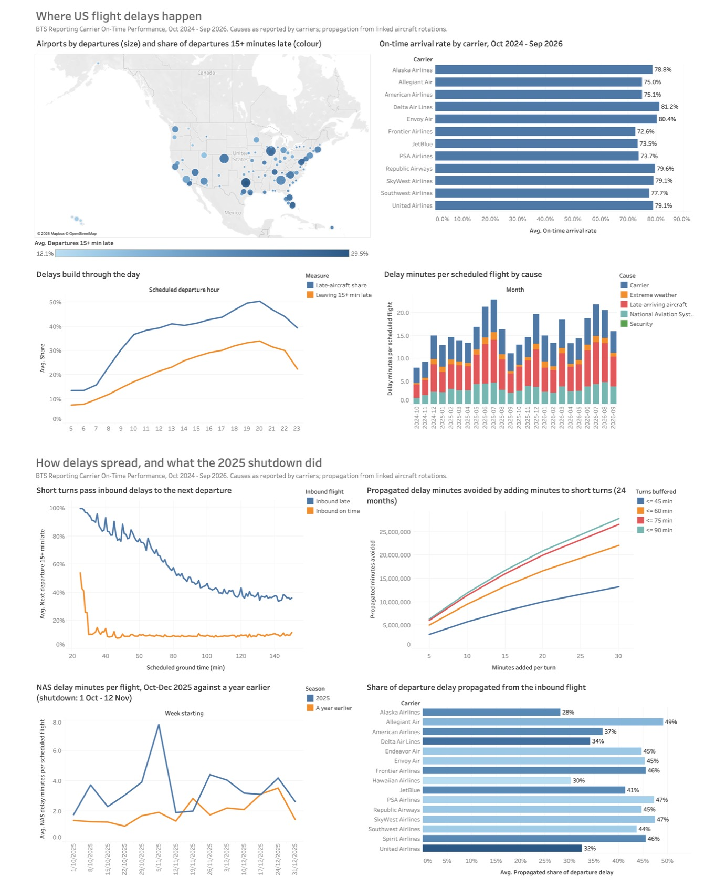

# US Airline Delays: Where They Start, How They Spread, What They Cost

**Which flights, airports and carriers lose the most time, how much of it is delay passed from one flight to the
next by the same aircraft, and would more scheduled turn time pay for itself?** This project analyses
14,082,099 scheduled US domestic flights (BTS on-time data, October 2024 to September 2026), links each
flight to the aircraft's previous flight to measure delay propagation, prices delays with airline cost data,
measures what the 2025 federal shutdown did to air traffic delays, and builds a model that flags high-risk flights
from the schedule alone.

**Tools:** SQL (DuckDB over 24 monthly Parquet files: window functions for aircraft rotations, grouping sets,
lateral unnest, quantiles) · Python (pandas, NumPy, statsmodels, LightGBM, scikit-learn) · Statistics (day-level
bootstrap, year-over-year comparison with Newey-West errors, calibration and lift) · Excel (delay cost model and
turn-buffer business case with formulas and data validation) · Tableau (two dashboards, Hyper extracts, map)



## Findings

1. **14,082,099 scheduled flights from 2024-10-01 to 2026-09-30:** 78.0% arrived on time (less than 15 minutes late), 1.6% were cancelled, and operated flights arrived 16.9 minutes late on average, 234.1 million minutes in total.
2. **Late-arriving aircraft is the largest cause of delay: 39.5% of delay minutes,** ahead of carrier causes (32.9%), the National Aviation System (21.2%) and extreme weather (6.3%). Each minute of original delay grows to 1.65 minutes as it moves through aircraft rotations.
3. **Delay builds through the day.** 7.8% of 6 am departures leave 15+ minutes late; by 20:00 it is 33.9%. The late-aircraft share of delay minutes rises from 14% to 50%.
4. **Scheduled turn time decides whether a delay spreads.** When the inbound flight arrived 15+ minutes late, 94% of departures after a 30-40 minute turn also left late, against 44% after a 90-120 minute turn (and 13% when the inbound was on time). Across 9.9 million linked aircraft turns, 41% of departure delay minutes were carried in from the inbound flight; turns of 45 minutes or less are 31% of turns and carry 43% of propagated minutes. The estimate agrees with the carriers' own late-aircraft coding on 85% of delayed flights (correlation 0.85).
5. **Delta Air Lines has the highest on-time rate of the 12 carriers that reported all 24 months** (81.2%, 95% interval 80.6% to 81.8%) and Frontier Airlines the lowest (72.6%). Frontier Airlines turns delay over most: 52% of its delay minutes come from late aircraft (multiplier 2.06, median scheduled turn 60 minutes) against 21% at SkyWest Airlines (1.27).
6. **A blanket schedule buffer does not pay for itself at the airline level.** Adding 15 minutes to every turn scheduled at 60 minutes or less would avoid 22% of propagated delay (13.4 million minutes over 24 months) but use 88.5 million aircraft minutes. Priced at A4A's 2025 cost rates, the airline saves $339 million a year in gate time and spends $607 million on aircraft time (net -$268 million); it breaks even only if extra ground time costs less than $7.65 a minute. Passengers would save $502 million a year in time. The same buffer on afternoon turns only (departures from 15:00) breaks even at $10.50 a minute.
7. **The 2025 shutdown hit hardest once the FAA cut flights.** In the five weeks before the cuts, the year-over-year change in NAS delay was +0.7 minutes per flight above its post-shutdown level (95% CI -0.4 to 1.7), too small to tell apart from zero, and the cancellation rate moved by -0.61 points (95% CI -1.17 to -0.04). During the shutdown days with flight cuts (7-12 November), NAS delay rose by +5.3 minutes per flight (95% CI 2.6 to 7.9), cancellations by +5.2 points (95% CI 3.57 to 6.92) and the on-time rate fell by 10.6 points. After the shutdown ended, NAS delay was back near normal (-0.5 minutes, 95% CI -1.4 to 0.4). The largest NAS increases were at LGA, JFK, EWR. Hurricane Milton (landfall 9 October 2024) cancelled many flights in the comparison year; with those days kept, the pre-cut cancellation change is -1.33 points.
8. **Schedule data alone flags the riskiest flights.** A LightGBM model trained on October 2024 - March 2026 and tested on 3,627,856 flights from April to September 2026 scores an AUC of 0.721 (baseline on carrier, hour and month: 0.648). The top risk decile was disrupted 60% of the time against 26% on average (2.3x) and the bottom decile 7%. The planned turn before the flight is the second most useful feature (17% of gain).





## Recommendations for an airline operations planning team

1. Protect the first wave: departures before 8 am are rarely late, and every minute they lose is carried through the day. Track first-departure on-time rate by hub as a daily operating KPI.
2. Add turn time where inbound delays are common, not across the board. A blanket 15-minute buffer on turns of 60 minutes or less breaks even only below $7.65 a ground minute; limited to afternoon turns the break-even rises to $10.50. Test the targeted version first at the airports with the most propagated delay, and confirm the true cost of an aircraft ground minute (the model's default is $13.71).
3. Use the risk model at schedule-build time: flights in the top risk decile are worth a longer planned turn, a spare aircraft or crew at the hub, or a swap with a lower-risk rotation.
4. Review Frontier Airlines' turn standards against SkyWest Airlines': the gap in delay multiplier (2.06 against 1.27) is mostly scheduled slack, which the airline controls.
5. Keep a playbook for air traffic control staffing events: during the FAA flight cuts, NAS delay and cancellations rose sharply within days. Early, planned cancellations on thin routes protect the hub banks.

## Deliverables

| Deliverable | Where |
|---|---|
| Tableau workbook: 2 dashboards, 8 sheets, 8 Hyper extracts | `dashboards/tableau/airline_delay_propagation.twbx` |
| CSV extracts used by Tableau | `dashboards/tableau/data/` |
| Excel delay cost model and turn-buffer business case | `excel/delay_cost_turn_buffer_model.xlsx` |
| Analysis notebook with outputs | `notebooks/airline_delay_propagation.ipynb` |
| One-page memo | `reports/memo.md` |
| SQL: staging, flights, 11 quality rules, rotations and propagation, buffer scenarios, scorecards, shutdown, model frame | `sql/` |
| Result tables and figures | `reports/tables/`, `reports/figures/` |



## How it works

1. **Staging** (`sql/00`, `src/data.py`): each monthly BTS zip is unpacked and written as typed Parquet (32 of 109
   columns).
2. **Warehouse** (`sql/01-02`): one table of 14,082,099 flights with clock times turned into minutes on each
   airport's local clock; 11 quality rules ([`docs/data_quality_log.md`](docs/data_quality_log.md)).
3. **Rotations** (`sql/03`): a window function over carrier and tail number links 9,925,386 turns; carrier
   minimum turn times; propagated and own departure delay for every turn.
4. **Analysis** (`sql/04-17`, `src/delays.py`): turn profile, buffer scenarios computed flight by flight, carrier and
   airport scorecards with a day-level bootstrap, hourly and monthly views, shutdown comparison against the same
   weekdays a year earlier.
5. **Risk model** (`src/model.py`): LightGBM on features known at schedule time, tested on the last six months.
6. **Business tools**: Excel cost model and buffer business case (`src/excel_model.py`); Tableau workbook
   (`src/tableau_workbook.py`).

Details: [`docs/methodology.md`](docs/methodology.md) · data dictionary: [`docs/data_dictionary.md`](docs/data_dictionary.md)

## Run it

```bash
python -m venv .venv && source .venv/bin/activate
pip install -r requirements.txt
make all        # download (about 730 MB), stage, warehouse, analysis, model, notebook, tests (about 10 minutes)
```

## Project structure

```
├── data/                 raw/ and processed/ (git-ignored); README with sources
├── sql/                  DuckDB SQL: staging, flights, quality rules, rotations, propagation, scorecards, model frame
├── src/                  pipeline: data, delays, model, figures, Excel, Tableau, report
├── notebooks/            executed analysis notebook
├── excel/                delay cost model and turn-buffer business case
├── dashboards/tableau/   .twbx workbook, CSV extracts, preview
├── reports/              results.json, memo, figures, tables
├── docs/                 methodology, data dictionary, data quality log
└── tests/                pytest suite
```

## Data

Bureau of Transportation Statistics, Reporting Carrier On-Time Performance (1987-present), monthly files for
October 2024 to September 2026 from [transtats.bts.gov/PREZIP](https://transtats.bts.gov/PREZIP/). Airport
coordinates from [OurAirports](https://ourairports.com/data/) (public domain). Cost per block minute from Airlines
for America, [U.S. Passenger Carrier Delay Costs](https://airlines.org/dataset/u-s-passenger-carrier-delay-costs/)
(2025, DOT Form 41). No account is needed. Raw files are not stored in this repository.

## Assumptions and limits

* Delay costs use industry averages: $98.41 per block minute (A4A, 2025),
  of which $50.72 (crew, ownership, other) is assumed to accrue at the gate; passenger time at
  $47 an hour and 95.9 passengers per departure
  (BTS). All are inputs in the Excel model.
* The cost of extra scheduled ground time (default $13.71 a minute, ownership plus other) is the
  assumption the buffer decision turns on; the Excel model shows the break-even value.
* Propagation uses one minimum turn per carrier. Buffer benefits count the next departure only, so they are a
  lower bound.
* Causes are coded by carriers. The shutdown comparison controls for season and weekday but not for weather
  differences between years.
* 3 carriers reported for fewer than 24 months; they are in the tables but
  not in the carrier ranking.

## License

Code, SQL and documentation are released under the [MIT License](LICENSE). The data is not covered by this license: it belongs to the publishers listed under Data and remains under their terms.
